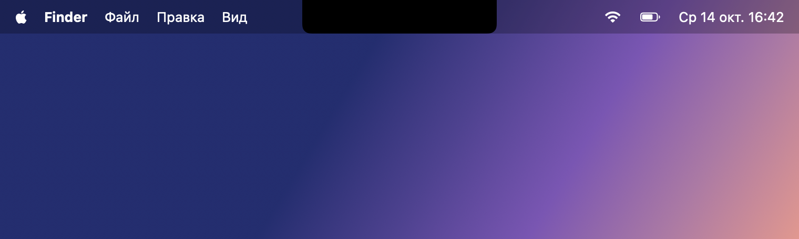
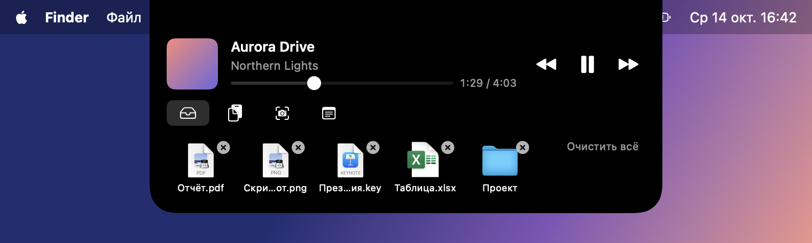
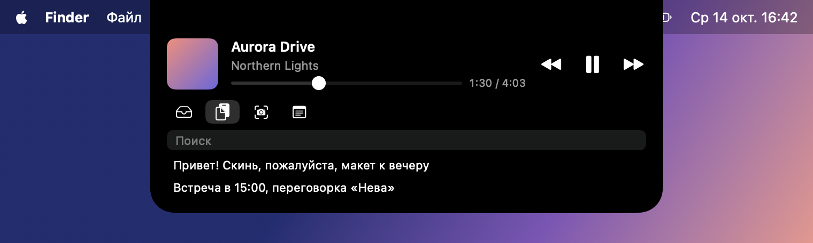
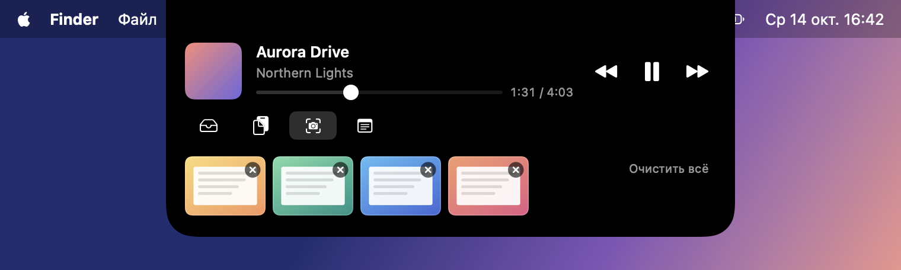
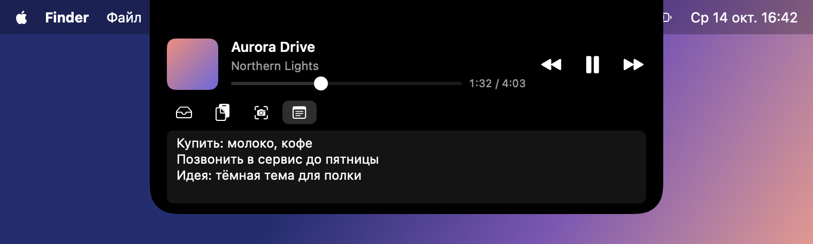

# Brow

Brow превращает вырез («чёлку») MacBook в мини-панель в стиле Dynamic Island. Наведите курсор на вырез, и из него плавно выезжает панель с виджетами. Уведите курсор, и панель свернётся.

## Как выглядит

В покое панель сливается с вырезом:



Курсор на вырезе: панель выезжает вниз. Сверху всегда музыка, под ней вкладки.

**Полка:** файлы, перетащенные на вырез.



**Буфер:** история скопированного текста с поиском.



**Скриншоты:** последние 5 снимков, сделанных в буфер обмена.



**Заметка:** один блокнот с автосохранением.



## Что умеет

- **Музыка:** название, обложка и прогресс того, что сейчас играет, в любом плеере, включая видео в браузере. Есть play/pause, предыдущий/следующий трек и перемотка ползунком.
- **Полка:** перетащите файл или папку к вырезу, и они лягут на полку. Потом вытащите их оттуда в любое место. На полке хранится ссылка на файл, сам файл не копируется. Если оригинал удалить или отправить в Корзину, он исчезнет с полки.
- **Буфер:** последние 50 скопированных текстов с поиском. Клик по записи снова кладёт её в буфер обмена, «×» убирает запись из истории, «Очистить всё» убирает все. Тексты из менеджеров паролей не сохраняются. Перетащите выделенный текст к вырезу, и он тоже попадёт в историю.
- **Скриншоты:** сделайте снимок через ⌘⇧5 с параметром «Сохранить в → Буфер обмена», и он появится на отдельной вкладке. Хранятся последние 5, более старые удаляются. Клик снова кладёт скриншот в буфер обмена, перетаскивание отдаёт его PNG-файлом в Finder, чат или письмо. «×» на миниатюре удаляет скриншот, «Очистить всё» удаляет все. Картинки, скопированные из браузера и других программ, сюда не попадают.
- **Заметка:** один блокнот с автосохранением. Пока вы печатаете, панель не сворачивается.

## Установка без Xcode

Самый простой способ: скачать готовое приложение. Подходит для MacBook с вырезом в экране (MacBook Pro 14" или 16" 2021 и новее, MacBook Air на M2 и новее) с macOS 14 Sonoma или новее.

### Шаг 1. Скачайте и положите в «Программы»

1. Откройте страницу [релизов Brow](https://github.com/freedrobili/brow/releases/latest) и скачайте файл `Brow-<версия>.zip`.
2. Откройте скачанный архив, если Safari не распаковал его сам. Появится `Brow.app`.
3. Перетащите `Brow.app` в папку **«Программы»** (в Finder: ⇧⌘A).

### Шаг 2. Разрешите запуск («Всё равно открыть»)

Brow не подписан платным сертификатом Apple, поэтому при первом запуске macOS его заблокирует. Это нужно разрешить **один раз**:

1. Откройте Brow двойным кликом в «Программах». macOS покажет предупреждение, что не может проверить приложение. Нажмите **«Готово»** (не «Переместить в Корзину»).
2. Откройте **Системные настройки → Конфиденциальность и безопасность**.
3. Пролистайте вниз до раздела **«Безопасность»**. Там будет написано, что «Brow» заблокирован. Нажмите **«Всё равно открыть»**.
4. Подтвердите паролем или Touch ID и в появившемся окне снова нажмите **«Открыть»**.

Дальше Brow запускается без вопросов. При первом запуске он сам включает автозапуск, см. [«Автозапуск»](#автозапуск).

> **Если macOS пишет, что Brow «повреждён»**, или кнопки «Всё равно открыть» нет: откройте **Терминал** (⌘Пробел → «Терминал»), выполните команду ниже и снова откройте Brow.
>
> ```bash
> xattr -dr com.apple.quarantine /Applications/Brow.app
> ```
>
> Команда снимает с Brow пометку «скачано из интернета», из-за которой срабатывает проверка.

### Шаг 3. Проверьте

Наведите курсор на вырез вверху экрана: должна выехать панель. Готово.

## Установка из исходников (нужен Xcode)

Этот способ для тех, кто хочет собрать Brow сам, например чтобы получать изменения сразу из репозитория.

### Что нужно

- **MacBook с вырезом в экране:** MacBook Pro 14" или 16" (2021 и новее), MacBook Air на M2 и новее.
- **macOS 14 Sonoma или новее.**
- **Xcode:** бесплатно в [App Store](https://apps.apple.com/app/xcode/id497799835). Он нужен, чтобы собрать приложение. Установка занимает время: Xcode весит несколько гигабайт.

### Шаг 1. Подготовьте Xcode

Установите Xcode из App Store и **откройте его один раз**. Согласитесь с лицензией и дождитесь, пока он доустановит компоненты. После этого Xcode можно закрыть, он больше не понадобится.

### Шаг 2. Скачайте Brow

Откройте программу **Терминал** (⌘Пробел → «Терминал») и выполните по очереди:

```bash
git clone https://github.com/freedrobili/brow.git
```

```bash
cd brow
```

Папка `brow` появится в вашей домашней папке.

### Шаг 3. Установите и запустите

В том же Терминале:

```bash
make install
```

Первая сборка занимает 1–2 минуты. Команда:
- собирает приложение;
- копирует его в папку «Программы» в вашей домашней папке (`~/Applications`);
- запускает Brow.

При первом запуске Brow сам включает автозапуск: дальше он будет стартовать при каждом включении Mac. macOS может показать уведомление о новом объекте входа, это и есть Brow.

### Шаг 4. Проверьте

Наведите курсор на вырез вверху экрана: должна выехать панель. Готово.

Если включить музыку или видео в браузере, оно появится в верхней части панели.

## Как пользоваться

- **Запуск:** Brow стартует сам при включении Mac. Если вы из него вышли, запустите его через Spotlight (⌘Пробел → «Brow»), Launchpad или Finder → «Программы» в домашней папке (⇧⌘H). Иконки в Dock у Brow нет: он живёт в вырезе.
- **Выход:** правый клик по раскрытой панели → «Выйти из Brow».
- **Автозапуск и скриншоты:** см. разделы [«Автозапуск»](#автозапуск) и [«Скриншоты»](#скриншоты) ниже.
- **Ваши данные** (история буфера, скриншоты, полка, заметка) лежат в `~/Library/Application Support/Brow/`.

## Скриншоты

Brow сохраняет скриншоты, которые вы делаете **в буфер обмена**. Настройте это один раз:

1. Нажмите **⌘⇧5**. Внизу экрана появится панель «Снимок экрана».
2. Нажмите **«Параметры»** и в разделе «Сохранить в» выберите **«Буфер обмена»**. macOS запомнит выбор.
3. Выделите область или окно и нажмите **«Снимок»**.

Скриншот сразу появится на вкладке с иконкой фотоаппарата (третья иконка):


Что с ним можно делать:
- **клик по миниатюре** снова кладёт скриншот в буфер обмена, дальше ⌘V в любой чат или документ;
- **перетаскивание миниатюры** в Finder, Telegram или письмо отдаёт его PNG-файлом «Снимок экрана <дата> в <время>.png»;
- **«×» в углу миниатюры** удаляет скриншот из Brow, **«Очистить всё»** удаляет все сразу.

Удаление касается только Brow: если скриншот или текст сейчас лежит в буфере обмена, ⌘V по-прежнему его вставит.

Хранятся последние 5 скриншотов, шестой вытесняет самый старый. Они сохраняются между перезапусками. Картинки, скопированные из браузера или других программ, на эту вкладку не попадают, только снимки экрана.

## Автозапуск

Brow запускается сам при каждом включении Mac. Автозапуск включается при первом запуске после установки, ничего настраивать не нужно. macOS при этом может показать уведомление о новом объекте входа.

- **Выключить или включить:** правый клик по раскрытой панели → **«Запускать при входе в систему»**. Галочка показывает, что автозапуск включён.
- **То же через Системные настройки:** «Основные → Объекты входа», Brow в списке «Открывать при входе».
- Если вы выключили автозапуск, Brow сам его больше не включит, даже после обновления.

## Обновление

**Если ставили готовое приложение:** выйдите из Brow (правый клик по панели → «Выйти из Brow»), скачайте новый `Brow-<версия>.zip` со [страницы релизов](https://github.com/freedrobili/brow/releases/latest) и замените `Brow.app` в «Программах». Разрешить запуск, возможно, придётся снова, как в шаге 2 выше.

**Если собирали сами:** в Терминале, в папке `brow`:

```bash
git pull
```

```bash
make install
```

Brow перезапустится уже новой версией. Данные и настройка автозапуска сохранятся.

## Удаление

1. Выключите автозапуск: правый клик по панели → снимите галочку «Запускать при входе в систему».
2. Выйдите из Brow: правый клик по панели → «Выйти из Brow».
3. Удалите приложение, его данные и настройки:

```bash
rm -rf /Applications/Brow.app ~/Applications/Brow.app ~/Library/Application\ Support/Brow
```

(Команда удаляет обе возможные копии: готовую из `/Applications` и собранную из `~/Applications`.)

```bash
defaults delete com.freedrobili.Brow
```

## Ограничения

- Музыка читается через приватный API Apple (MediaRemote), и будущие версии macOS могут его сломать. Тогда блок музыки покажет «Нет данных о воспроизведении», а остальное продолжит работать.
- Работает только на встроенном экране с вырезом. Если крышка закрыта и вы работаете только с внешним монитором, панель скрыта.
- Brow не подписан сертификатом разработчика Apple и не проходит нотаризацию, поэтому готовое приложение при первом запуске нужно разрешить вручную (см. [«Установка без Xcode»](#установка-без-xcode)). Автообновления нет: новые версии скачиваются со страницы релизов.

## Для разработчиков

```bash
make run    # собрать копию для разработки и запустить
make app    # только собрать
make test   # автотесты
make release  # тесты + архив Brow-<версия>.zip для GitHub Releases (в .build/dist)
```

Makefile сам указывает на Xcode в `/Applications/Xcode.app`, переключать `xcode-select` не нужно.

- `Sources/BrowCore` — вся логика без UI, покрыта тестами: геометрия выреза, состояния панели, история буфера, полка, заметка, разбор данных о музыке.
- `Sources/Brow` — приложение: окно `NSPanel` над вырезом, отслеживание мыши, SwiftUI-виджеты.
- `Sources/BrowMediaRemote` + `Resources/brow-media.pl` — helper для музыки. Начиная с macOS 15.4 Apple пускает к MediaRemote только свои процессы, поэтому helper загружается в системный `/usr/bin/perl`.

Документы: [спецификация](docs/superpowers/specs/2026-10-14-brow-design.md), [план реализации](docs/superpowers/plans/2026-10-14-brow-mvp.md).
